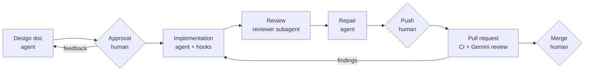

# 0002 — Agent guardrails and Gemini PR review (rollout plan)

Status: approved 2026-11-22 · implemented in PRs #1–#4 and #6.
Written before 0001 (in a shared doc, moved here in step 6); numbered by arrival in the repo.

## Goal and context

The rules in `AGENTS.md` should stop being a declaration: machines enforce them while the agent
works, and a second model (Gemini) checks them independently on every pull request.

At the start `budget-api` had clean code and a rules file, but a reader of the repo only saw the
file. Nothing showed that the agent must follow it or that the process is controlled. The goal:
two minutes on GitHub show

- **guardrails**: hooks and tests that catch a broken rule before it reaches the repo,
- **process**: design doc, implementation, review, repair, merge,
- **evidence**: a PR history with review findings and the commits that fixed them.

## Scope

In: the public repo and its protection; Claude Code hooks; an architecture test; a reviewer
subagent and commands in `.claude/`; ADRs in `docs/adr/`; Gemini PR review in GitHub Actions;
design docs in `docs/design/` and a README section on how the repo is built.

Out (each would get its own design doc): new business features (CSV import, recurring
transactions), an MCP server for the budget, an LLM inside the app.

## Proposed changes

Every rule in `AGENTS.md` is checked in at least one place: while the agent works or in CI.

| Part | Files | How it works | What it proves |
| --- | --- | --- | --- |
| Repo protection | GitHub settings, rulesets | PRs *Collaborators only*; a ruleset on all branches blocks force pushes and deletions; `main` accepts changes only through a PR with green CI | Nobody outside can push or open PRs; history cannot be rewritten |
| Claude Code hooks | `.claude/settings.json`, `.claude/hooks/` | After every edit `ruff` on the changed file, errors go back to the agent; at the end of a turn `mypy` and the architecture test; editing a migration already on `main` is blocked; `git commit`/`push` asks the human | Rules are enforced during the work, not just written down |
| Architecture test | `tests/test_architecture.py` | Reads each module's imports with stdlib `ast` and compares them with the layer table | The table in `AGENTS.md` is true, because breaking it fails the tests |
| Subagent and commands | `.claude/agents/reviewer.md`, `.claude/commands/` | The reviewer checks a change against `AGENTS.md` in a fixed format; commands are recipes (design doc, new endpoint) | Work is split into roles and repeatable procedures |
| ADRs | `docs/adr/0001–0004` | Four short decisions the agent reads before changing related code | Decisions keep their reason and are not quietly undone |
| Gemini PR review | `.github/workflows/ai-review.yml`, `scripts/ai_review.py` | On every PR the diff and `AGENTS.md` go to Gemini; findings come back as line comments | Independent review by a different model, built into the process |
| Design docs in the repo | `docs/design/`, README | Approved design docs live next to the code | Changes start from a design, not from code |

## Agent workflow

The agent stays inside its steps: no code without approval, nothing reaches GitHub until the
human asks for the push, and only the human merges.

## Alternatives and decisions

| Decision | Choice | Rejected | Why |
| --- | --- | --- | --- |
| Who can contribute | PRs restricted to *Collaborators only* (GitHub setting, Feb 2026) | Default public repo; temporary interaction limits | Outsiders cannot push or open PRs; interaction limits expire after at most 6 months |
| History protection | Ruleset on all branches: no force push, no deletion | Protection on `main` only | A force push to a feature branch would rewrite the PR history that serves as evidence |
| Architecture test | Own test on `ast` | `import-linter` | No new dependency or config; short enough to read |
| When `mypy` runs in hooks | End of the agent's turn | After every edit | `mypy` takes seconds; `ruff` is instant |
| Git approval | Ask (`permissions.ask`) | Hard block | A block would also stop the push the human asked for |
| Gemini integration | Own script on the API | Antigravity CLI; Gemini Code Assist enterprise | The consumer Code Assist GitHub app was shut down in 2026; enterprise needs a paid licence; an own script needs no licence and gives full control of the prompt and the failure handling |
| Review form | One PR review with line comments | One summary comment | Reads like a human review; findings outside the diff go to the summary |
| Does Gemini block merge | No, advisory | Required check | API limits could lock the repo; the gate is CI |

## Risks and costs

Cost is about $0: Actions are free for public repos and the review runs on a free-tier key.

| Risk | Mitigation |
| --- | --- |
| Prompt injection in the diff | The workflow token has only `contents: read` and `pull-requests: write`; the model can comment, never change code; rules come from the base branch |
| Missing API key, quota or outage | Green skip with a note; the review never blocks merge |
| Hooks run only in Claude Code | CI checks the same rules; hooks are the fast loop, CI is the gate |
| Free-tier data may be used for training | The repo is public; secrets are never sent |

## Rollout and results

| Step | PR | Result |
| --- | --- | --- |
| 1. Repo start and protection | (initial commits on `main`) | Public repo, CI green on the first run, rulesets and *Collaborators only* active |
| 2. Gemini review | [#1](https://github.com/JasperBTA/budget-api/pull/1) | Live; first runs hit `503`, retries added; first review posted |
| 3. Architecture test | [#2](https://github.com/JasperBTA/budget-api/pull/2) | Layer table enforced; unit tests no longer need Postgres |
| 4. Hooks | [#3](https://github.com/JasperBTA/budget-api/pull/3) | Hooks live; CI step added for merged migrations |
| 5. Reviewer subagent and commands | [#4](https://github.com/JasperBTA/budget-api/pull/4) | Reviewer read-only enforced by a hook in its header |
| 6. ADRs and process docs | [#6](https://github.com/JasperBTA/budget-api/pull/6) | `docs/adr/`, `docs/design/`, `docs/pipeline.md`, README |

Follow-up outside the plan: [design 0001](0001-gemini-fallback-model.md),
[#5](https://github.com/JasperBTA/budget-api/pull/5), a fallback model after the primary answered
1 of 5 reviews.

### Changes during implementation

- `google-genai` went into the `dev` dependency group, not a separate `review` group: same effect
  (the Docker image installs without dev), simpler.
- The git approval uses the built-in `permissions.ask` rule instead of a hook script.
- A CI step now rejects PRs that change merged migrations: review showed the hook alone sees only
  the agent's Edit/Write tools.
- The reviewer's "read-only" became a mechanism (a PreToolUse hook in its own header) after
  review showed it was only requested.

### Acceptance criteria

- [x] Importing `fastapi` in `domain/` fails `pytest` (probed in #2).
- [x] A `ruff` error after an edit goes back to the agent (fired live while #3 was written).
- [x] Editing migration `0001` is denied by the hook (pipe-tested; CI diff check added in #3).
- [x] A Gemini review appears on a PR (#1, #5).
- [ ] A Gemini review cites an `AGENTS.md` rule: the two posted reviews had one false positive
      (#1) and no findings (#5).
- [x] When the API fails, the job ends green with a skip note (live on #1–#4); without a key it
      skips too (`tests/unit/test_ai_review.py::test_missing_key_skips`).
- [x] A non-collaborator cannot open a PR (`pull_request_creation_policy: collaborators_only`).
- [ ] A force push is rejected by GitHub: the ruleset is active, but a live attempt was blocked
      on the agent's side as destructive and not repeated.
- [ ] `git commit` from the agent asks for approval: the rule exists; to be confirmed in a fresh
      session.
- [ ] A PR with a planted bug gets a Gemini comment on that line: not run yet.
