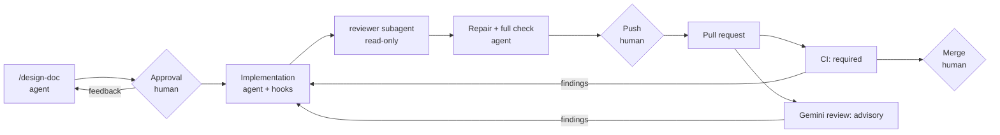

# How a change gets into `main`

This repository is built by a coding agent (Claude Code) under rules that machines check, with a
human deciding at three points. This page shows the path of a change, what enforces each rule,
and real pull requests where the checks caught something.

## The path of a change

1. **Design doc.** A change that adds a table, rule, resource, endpoint or dependency starts with
   `/design-doc` ([command](../.claude/commands/design-doc.md)). It lands in
   [`docs/design/`](design/) and waits for the human's approval.
2. **Implementation.** Hooks run while the agent edits (table below).
3. **Review.** The [`reviewer`](../.claude/agents/reviewer.md) subagent checks the change against
   [`AGENTS.md`](../AGENTS.md). It has no Edit/Write tools, and its Bash is limited to an
   allowlist of read-only commands by a [guard](../.claude/hooks/guard_readonly_bash.py) in its
   header. Known gap, noted in the guard: a `python -c` probe could still write a file.
4. **Repair.** The agent fixes verified findings, says which it skipped and why, and runs the full
   check again.
5. **Push.** Only when the human asks (`git commit`/`git push` prompt for approval).
6. **Pull request.** CI is the required gate. Gemini adds an independent, advisory review.
7. **Merge.** Only the human merges; a ruleset makes a PR with green CI the only way into `main`.

## What enforces which rule

| Rule (AGENTS.md) | While the agent works | On the pull request |
| --- | --- | --- |
| Lint and formatting | `ruff` on every edited file ([hook](../.claude/hooks/lint_changed_file.py)) | `ruff check`, `ruff format --check` (CI) |
| Types: `mypy --strict` | at the end of a turn that changed Python files ([hook](../.claude/hooks/check_on_stop.py)) | `mypy` (CI) |
| Layer table: `api → services → domain` | at the end of a turn that changed Python files (same hook) | [`tests/test_architecture.py`](../tests/test_architecture.py) (CI) |
| Business rules 1–6, user isolation | reviewer subagent | `pytest` against real PostgreSQL (CI), Gemini review |
| Never edit a merged migration | edit denied ([hook](../.claude/hooks/guard_migrations.py)) | `git diff` against the base branch (CI) |
| Migrations downgrade cleanly | — | tests run `downgrade base` + `upgrade head` (CI) |
| Design first, review then repair | [`/design-doc`](../.claude/commands/design-doc.md), [`reviewer`](../.claude/agents/reviewer.md) | — (convention: the PR description links its design doc, as in #5) |
| Git only on request; history protected | `permissions.ask` in [`settings.json`](../.claude/settings.json) | ruleset: `main` only through a PR with green CI; no force push or branch deletion anywhere |
| Hooks and agent files stay valid | — | [`tests/test_hooks.py`](../tests/test_hooks.py), [`tests/test_claude_config.py`](../tests/test_claude_config.py) |

Hooks are the fast loop and run only in Claude Code. CI checks the same rules for any agent or
human, so it is the gate.

## Evidence: what the checks caught

| PR | What happened |
| --- | --- |
| [#1](https://github.com/JasperBTA/budget-api/pull/1) Gemini review | The first two runs hit `503 high demand` and skipped green, as designed; retries with backoff were added. The first posted review flagged `httpx2` as breaking the test client: a false positive, checked against Starlette's source and the green CI run. An advisory reviewer cannot be the gate. |
| [#2](https://github.com/JasperBTA/budget-api/pull/2) Architecture test | The subagent review found two ways around the test (relative imports, SQL through a variable not named `session`). Both closed; four of the rules were proven by injecting a violation and watching the test fail. A merge conflict with #1 was resolved by merging `main`, since force pushes are blocked. |
| [#3](https://github.com/JasperBTA/budget-api/pull/3) Hooks | The lint hook fired live while the PR was written (`E501` returned to the agent). The review found that nothing in CI caught an edited merged migration; a CI diff step was added. |
| [#4](https://github.com/JasperBTA/budget-api/pull/4) Reviewer subagent | Review found that "read-only" was only a request, since the reviewer has Bash. It became a hook in the subagent's header; writing its tests caught two bugs in the guard itself. |
| [#5](https://github.com/JasperBTA/budget-api/pull/5) Fallback model | Designed with `/design-doc` and approved before code ([design 0001](design/0001-gemini-fallback-model.md)); first live run of the `reviewer` subagent. On the PR the primary model returned `429 quota`, and the fallback model answered and posted the review. |

## When something fails

| Situation | Behaviour |
| --- | --- |
| Gemini key missing or rejected, bad request, invalid answer | The review is skipped at once with the reason in the job summary. |
| Quota used up, model unknown, API down or slow | The fallback model is tried; if it fails too, the review is skipped with each model's error in the job summary. |
| Any review failure | The PR is never blocked: the review is advisory, CI is the gate. |
| A hook script cannot run | The edit goes ahead (hooks fail open); CI still checks the rule. |
| The stop hook finds a failure | The agent is sent back once to fix it; after that, CI decides. |

## Decisions behind the code

Architecture decisions with their reasons are in [`docs/adr/`](adr/): no repository layer, 404
instead of 403, `Decimal` for money, synchronous SQLAlchemy. Design docs for process changes are
in [`docs/design/`](design/).
